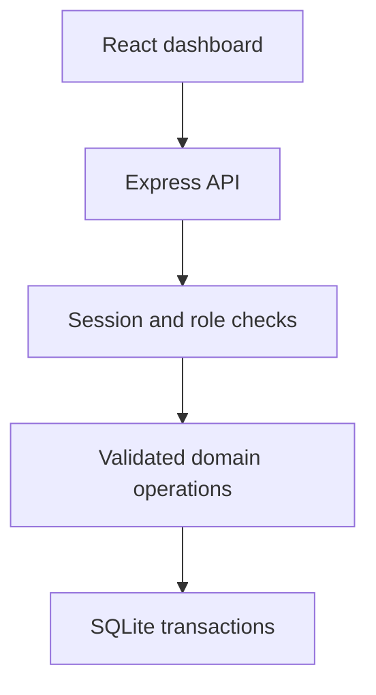

# InvoicePilot

A freelancer billing workspace with invoices, partial payments, PDF export and a reviewable reminder outbox.

Built with React, TypeScript, Express, Node.js 24 and SQLite. This is a working portfolio MVP, not a hosted production service.

## Run in three commands

Install **Node.js 24 or newer**, then open a terminal in this folder:

```sh
npm ci
npm run build
npm run demo
```

Open http://127.0.0.1:3000. Demo login:

- Administrator: `admin@demo.local`
- Read-only viewer: `viewer@demo.local`
- Password for both: `PortfolioDemo!2026`

These credentials are synthetic and intentionally public. Use demo mode only locally with synthetic data. Demo users are created only when the database is empty. Data persists in `data/app.sqlite` and is excluded from Git.

For development: `npm run dev` (Vite frontend on port 5173, API on 3000). For a second simultaneous project, set a different `PORT` when running the built app. In PowerShell: `$env:PORT="3001"; npm run demo`.

## Verification

```sh
npm run build
npm test
```

The test suite launches a real HTTP server with a fresh in-memory SQLite database per test. It checks authentication, protected writes, administrator/viewer roles and organization isolation, along with domain rules. `.github/workflows/ci.yml` runs the build and tests on push and pull request. A workflow file is included; a green GitHub CI run must be verified after publication.

## Architecture



- `web/`: responsive dashboard and typed API helper.
- `src/base.ts`: password hashing, expiring sessions, request protection and role checks.
- `src/app.ts`: domain routes and transactional persistence.
- `src/server.ts`: server entry point.
- `tests/`: HTTP integration tests.

SQLite makes the demo self-contained. Organization IDs scope each domain query; tests cover cross-organization access. There is no organization signup or team invitation UI yet. Single-process execution and synchronous SQLite transactions keep the prototype small; PostgreSQL and a durable queue are future work for distributed deployment.

## Non-demo startup

Copy `.env.example` to `.env`, set a unique administrator email and a password of at least 16 characters, and choose a fresh `DB_PATH`. Then run `npm start`. Bootstrap credentials are only used for an empty database; editing the environment does not change an existing account password.

For a public deployment, configure HTTPS at a reverse proxy, set `NODE_ENV=production` to require secure session cookies, persist the data volume, configure backups and review proxy/rate-limit configuration. The prototype has no password reset, MFA or account-management screens.

A Dockerfile is provided, but Docker execution was not verified in the build environment. It defaults to non-demo startup and needs `ADMIN_PASSWORD`. Avoid publishing the demo with known credentials.

## API conventions

All write requests need `Content-Type: application/json` and `X-Requested-With: portfolio-app`. Login sets an HttpOnly, SameSite=Strict cookie; other endpoints require that session. Mutations require the administrator role. API errors return `{"error":"..."}` and an appropriate HTTP status. The health endpoint is public.

| Method | Path | Purpose |
|---|---|---|
| POST | `/api/login` | Sign in with email/password |
| GET | `/api/me` | Current user and role |
| POST | `/api/logout` | Revoke the current session |
| GET | `/api/dashboard` | Organization-scoped workspace data |

## Implemented features

- Client records and fixed-amount milestone invoices denominated in PKR.
- Integer paisa accounting: no floating-point storage of money.
- Partial payments, outstanding balances and overpayment rejection.
- Idempotent payment references with conflicting reuse rejected.
- Server-generated PDF invoices with current balances.
- Overdue reminder drafts, explicit approval and manual copy for sending.
- One reminder per invoice per UTC date; payments invalidate old draft/approved reminders.
- Administrator and viewer roles with organization-scoped data.

| Method | Path | Purpose |
|---|---|---|
| POST | `/api/clients` | Create a client |
| POST | `/api/invoices` | Create a milestone invoice |
| POST | `/api/invoices/:id/payments` | Record a partial/full payment |
| GET | `/api/invoices/:id/pdf` | Download a PDF invoice |
| POST | `/api/invoices/:id/reminders` | Generate an overdue reminder draft |
| POST | `/api/reminders/:id/approve` | Approve the current draft for manual sending |

### Example payment

```json
{"amount":500000,"reference":"BANK-TRANSFER-001"}
```

Amounts are integer paisa: `500000` means PKR 5,000. Repeating the same reference, invoice and amount returns the original payment without adding it twice. Conflicting reuse returns 409. Payment records are not proof of actual bank settlement.

### Two-minute interview demo

1. Sign in: the synthetic invoice has PKR 125,000 total, PKR 25,000 paid, and PKR 100,000 due.
2. Record a PKR 10,000 payment using a unique reference.
3. Download the updated PDF showing PKR 90,000 outstanding.
4. Generate and approve a reminder containing the remaining balance.
5. Explain how duplicate references, overpayments and stale reminders are prevented.

### Boundaries

There is no bank connection, payment processing or email delivery. Approved reminders are copied and sent manually. The outbox does not claim an email was sent. Durable background jobs, retries, email-provider integration, multi-currency, tax calculations, itemized invoices, aging buckets, team invitations and organization signup are future work. Each invoice has a single milestone description and amount. Due-date and reminder deduplication calculations use UTC. PDF text uses standard built-in fonts; complex non-Latin shaping is not supported yet.

### CV description

Built a freelancer invoicing application with partial-payment tracking, PDF invoices, organization-scoped access, idempotent payment recording, and approval-based reminder drafts.
